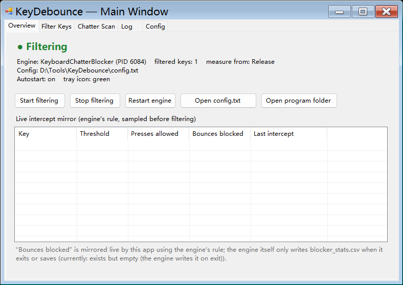

# KeyDebounce

A per-key **keyboard chatter (switch bounce) filter** for Windows — with a tray app,
a configuration UI, a chatter scanner and a live intercept log.

A worn key switch bounces for a few milliseconds as it closes, so one physical press
reaches the operating system as two or three presses: you type `helllo`, or an ability
fires twice. KeyDebounce drops the *physically impossible* extra presses — **only for
the keys you list** — and shows you exactly what it suppressed and by how many
milliseconds.



> **Software hides the symptom; it does not repair the switch.** The bounce window
> widens as the switch wears, and once it overlaps your fastest deliberate repeat no
> threshold can separate the two. The durable fix is a new switch. KeyDebounce buys
> time — and tells you when that time is up.

---

## Features

- **Per-key thresholds.** Only the keys you add are filtered; everything else keeps its
  original timing (`global_chatter: 0`, no added latency).
- **Measured, not guessed.** A built-in scanner watches the *raw* keyboard signal and
  flags any key whose press-to-press gap is under 40 ms — physically impossible for a
  human — then adds it to the filter in one click.
- **Live intercept log.** Every suppressed bounce with its measured gap in
  milliseconds, plus a per-key counter of presses allowed vs bounces blocked.
- **Tray-first, boot-to-shutdown.** Green tray icon = filtering. The launcher restarts
  the engine automatically if it ever dies, honouring a deliberate pause.
- **Bilingual UI** (English / Chinese, auto-detected from the system language, with
  `--en` / `--zh` overrides).
- **Portable and install-free.** Copy the folder anywhere and run one `.exe`. No
  installer, no kernel driver, no service, no registry values; the only system change
  is one optional shortcut in your Startup folder.
- **Small, auditable core.** ~1400 lines of C# 5, built by the compiler that ships
  with Windows. No NuGet packages, no bundled SDK, and **no network code at all**.

## Quick start

1. Put `KeyDebounce.exe` and `KeyboardChatterBlocker.exe` in the same folder
   (see [INSTALL.md](INSTALL.md) for where the engine comes from).
2. Run `KeyDebounce.exe`. A tray icon appears; the engine starts with it.
3. Double-click the tray icon → **Filter Keys** → **Add key…** → press the key that
   double-types. Save. Done.

Full instructions: **[INSTALL.md](INSTALL.md)** · configuration reference and UI tour:
**[USAGE.md](USAGE.md)**

## Repository layout

```
KeyDebounce/
├─ src/                     C# source (C# 5, in-box compiler)
│  ├─ KeyDebounce.cs        tray launcher, config, self-heal, engine lifecycle
│  ├─ KeyDebounce.Ui.cs     main window, key manager, scanner, live mirror
│  ├─ Lang.cs               English/Chinese translation table
│  └─ build.cmd             one-click build (uses csc.exe, no SDK needed)
├─ tools/                   development & measurement tooling
│  ├─ keychatter_probe.py   Raw Input chatter probe (measures real bounce width)
│  ├─ analyze_capture.py    turns a capture into per-key gap histograms
│  ├─ debouncer_chain_test.py  hook-chain test: proves what reaches applications
│  ├─ wrap_i18n.py          wraps/validates UI strings for translation
│  └─ capture_ui.ps1        screenshots a window for docs/bug reports
├─ docs/                    screenshot(s)
├─ INSTALL.md  USAGE.md     installation and usage documentation
├─ CHANGELOG.md  SECURITY.md  THIRD-PARTY-NOTICES.md
├─ 使用说明.md               Chinese usage notes
└─ LICENSE                  MIT
```

## How it works

**Filtering** is done by the upstream engine
[KeyboardChatterBlocker](https://github.com/FreneticLLC/KeyboardChatterBlocker)
(v1.21, MIT), driven by `config.txt`. KeyDebounce is the launcher/UI around it: it owns
the engine's lifecycle (one instance only — two engines would install two keyboard
hooks), regenerates `config.txt` when missing, and validates key names before saving,
because an unknown `key.` name makes the engine pop a modal error at startup.

**The live mirror** is the interesting part. The engine writes its statistics file only
when it saves its own configuration, so that file cannot drive a live view. Instead
KeyDebounce installs its **own** low-level keyboard hook *after* the engine's — Windows
calls hook procedures newest-first, so this hook observes the stream *before* the engine
filters it — and replays the engine's rule (per-key threshold, measured from the last
*accepted* press or release, with blocked presses not resetting the clock) to count and
log each suppressed bounce.

**Choosing a threshold.** Measure both clusters and sit between them. On the worn
CHERRY `046A:00E3` this project started from: bounce rebounds arrived 4.7–10.3 ms after
their release, genuine repeats were ≥ 95 ms apart, so `key.E: 50` with
`measure_from: Release` lands in the empty band with ~2× margin on both sides.
`tools/keychatter_probe.py` reproduces that measurement on any keyboard.

## Requirements

- Windows 7 / 8 / 10 / 11 (x64 or ARM64)
- .NET Framework 4.7.2+ (already present on Windows 10/11)
- The engine binary `KeyboardChatterBlocker.exe` (upstream MIT release)

## Building

```bat
cd src
build.cmd
```

`build.cmd` calls `C:\Windows\Microsoft.NET\Framework64\v4.0.30319\csc.exe` — the C#
compiler bundled with .NET Framework. No Visual Studio, SDK or NuGet required. The
same command runs in CI (`.github/workflows/build.yml`).

## Limitations

Briefly: a user-space hook cannot filter the secure desktop (UAC/logon) or keys typed
into **elevated** windows (unless this app is elevated too), and it cannot see programs
that read the keyboard through the Raw Input API. A global keyboard hook is also
indistinguishable from input automation to some kernel-level anti-cheat systems, so
competitive online games are best excluded via `auto_disable_programs`. Full list with
explanations: [USAGE.md §8](USAGE.md).

## Credits

- **Engine:** [KeyboardChatterBlocker](https://github.com/FreneticLLC/KeyboardChatterBlocker)
  by Alex "mcmonkey" Goodwin and Frenetic LLC (MIT) — see
  [THIRD-PARTY-NOTICES.md](THIRD-PARTY-NOTICES.md).
- The measurement-first workflow (raw capture → gap histogram → threshold in the empty
  band) and the hook-chain verification trick came out of debugging a real chattering
  keyboard; both are reproducible with the scripts in `tools/`.

## Contributing

Issues and pull requests are welcome. Two rules keep the project honest:

1. **Never change a default threshold without a measurement.** Include the capture
   (`tools/keychatter_probe.py N --csv out.csv`) or the reasoning in the PR.
2. **UI strings are Chinese in the source and translated at runtime.** Add new strings
   as Chinese literals, then run `tools/wrap_i18n.py wrap <files>` and
   `tools/wrap_i18n.py check src/Lang.cs <files>` — the check must report
   `full coverage` before a PR is merged.

Security-related reports: see [SECURITY.md](SECURITY.md).

## License

MIT — see [LICENSE](LICENSE). The redistributed engine binary keeps its own MIT
license and copyright (see [THIRD-PARTY-NOTICES.md](THIRD-PARTY-NOTICES.md)).
